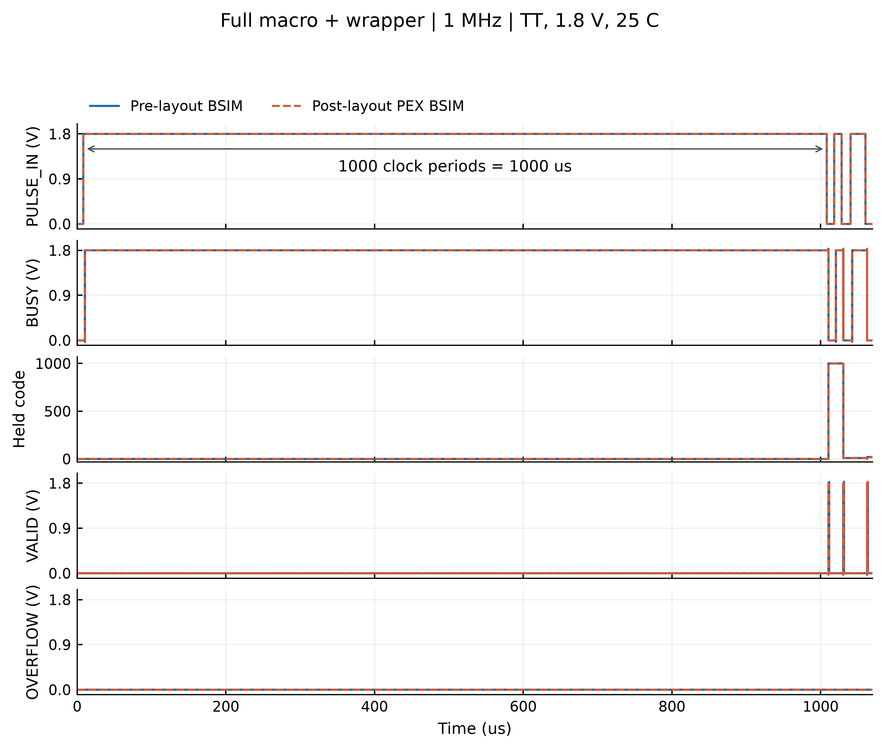
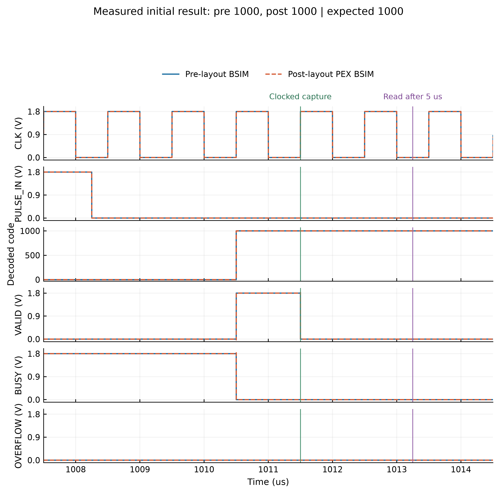

# Exact 1000-cycle TDC bring-up: measured BSIM/PEX results

Source: b1c7dec19f113eb7fe47a1986d12d9c465be0c28.
GDS SHA256: 2c66650721f9d8c3d54b18e39038064a20b95f048d1b69d987ed50766105bd40.

1 MHz, TT, 1.8 V core, 25 C. Both simulations run one continuous 1070 us transistor transient.
Numerics: TSTEP 2 ns, maximum timestep 20 ns, Gear, reltol 1e-4; no pause/resume or stitched counter states.

| Check | Pre-layout | Post-layout PEX |
| --- | --- | --- |
| Captured code | 1000 | 1000 |
| Code read 5 us after falling edge | 1000 | 1000 |
| Overflow | 0 | 0 |
| VALID width (us) | 0.9999563932456407 | 0.9999941172566217 |
| uo at read | 0xE8 | 0xE8 |
| uio at read | 0x03 | 0x03 |

Overall test passed: **True**. Actual measured values are preserved even when a run fails.

Applied edges: reset low for 0.5, 1.5, 2.5, 3.5 us rising edges. Reset releases at 4 us; input stays low at 4.5, 5.5, 6.5, 7.5 us.
Input rises at 8.25 us and falls at 1008.25 us. Held result is read at 1013.25 us. Two further 10 and 20 us pulses check successive capture.

All 24 wrapper outputs are checked at 1070 clock samples per model. Hardware capture is an ideal external sampling checker of actual analog node voltages, not a simulated physical board receiver.

Scope: all 108 pre-layout or 139 routed active macro cells, including the wrapper. Post-layout uses actual GDS MOS geometry, cell metal capacitance and nominal OpenRCX intercell R/C. Supplies are ideal; power-only cells are omitted. Intracell metal resistance and assembled shared mux/pads/package/PCB are outside this extraction.

An earlier exploratory coarse-timestep pre-layout run produced 1016. A targeted carry test passed with the original finer settings; this workflow therefore reruns both full models using those finer controls. The exploratory result is not a pass result or a confirmed silicon defect.

Post-layout raw data and decks: https://github.com/Ahmed-Reda-SILO/tt_um_armohamed_tdc12/actions/runs/44803427615 (artifact tdc12-post-raw).
Pre-layout raw data and decks: https://github.com/Ahmed-Reda-SILO/tt_um_armohamed_tdc12/actions/runs/44799177056 (artifact tdc12-pre-raw).

